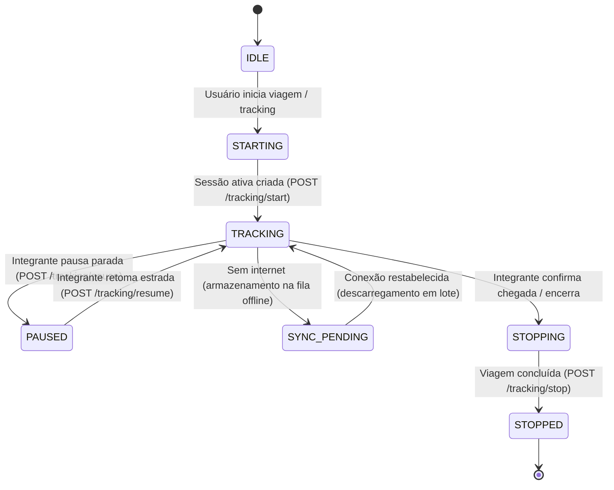

# GPISSI — Arquitetura de Rastreamento GPS em Segundo Plano (Background Tracking)

## 1. Visão Geral
O sistema de rastreamento em segundo plano do GPISSI foi desenvolvido para garantir a segurança dos integrantes do **Insanos MC** durante suas viagens nas estradas brasileiras. O sistema opera tanto em navegadores web modernos (mobile e desktop) quanto em aplicativos móveis híbridos nativos empacotados via **Capacitor** (Android e iOS).

### Princípios de Engenharia:
- **Resiliência a Áreas de Sombra:** Operação autônoma durante perdas de sinal 3G/4G/5G, armazenando coordenadas localmente na fila persistente e sincronizando em lote quando a conectividade for restabelecida.
- **Deduplicação e Idempotência:** Garantia de que retransmissões não criem registros duplicados através de identificadores únicos universais (`point_uid`) e restrições únicas no banco de dados.
- **Conversão Única de Velocidade:** Tratamento unificado de telemetria de velocidade garantindo que a conversão entre unidades (m/s para km/h) ocorra apenas uma vez.
- **Distinção Visual em Rota:** O mapa interativo (MapLibre GL JS / OpenFreeMap) diferencia a rota planejada calculada (azul tracejada) do percurso real registrado por satélite (laranja/verde contínua).

---

## 2. Ciclo de Vida da Sessão de Tracking

A sessão de rastreamento possui estados bem definidos gerenciados tanto pelo cliente (`TrackingStatus.js`) quanto pelo servidor backend (`tracking_sessions`):



### Estados:
| Estado | Descrição |
| :--- | :--- |
| `IDLE` | Aguardando ativação pelo autor da viagem. |
| `STARTING` | Inicializando provedores nativos ou HTML5 Geolocation e WakeLock. |
| `TRACKING` | Capturando coordenadas e transmitindo em tempo real ou enfileirando. |
| `PAUSED` | Rastreamento temporariamente pausado (parada programada / abastecimento). |
| `SYNC_PENDING` | Pontos acumulados na memória do dispositivo aguardando sinal de internet. |
| `STOPPED` | Sessão concluída com `ended_at` carimbado e trajeto consolidado. |

---

## 3. Esquema de Dados (SQLite / Turso libSQL)

### Tabela `tracking_sessions`
Armazena as sessões de rastreamento vinculadas às viagens e usuários:
```sql
CREATE TABLE IF NOT EXISTS tracking_sessions (
  id TEXT PRIMARY KEY,
  tenant_id TEXT DEFAULT 'insanos-mc',
  viagem_id TEXT NOT NULL,
  user_id TEXT NOT NULL,
  vehicle_id TEXT DEFAULT '',
  status TEXT DEFAULT 'TRACKING', -- TRACKING, PAUSED, STOPPED
  started_at TEXT NOT NULL,
  paused_at TEXT,
  resumed_at TEXT,
  ended_at TEXT,
  last_point_at TEXT,
  created_at TEXT NOT NULL,
  updated_at TEXT NOT NULL
);
CREATE INDEX IF NOT EXISTS idx_tracking_sessions_viagem ON tracking_sessions(viagem_id);
CREATE INDEX IF NOT EXISTS idx_tracking_sessions_user ON tracking_sessions(user_id);
```

### Tabela `tracking_points`
Armazena os pontos de telemetria georreferenciados:
```sql
CREATE TABLE IF NOT EXISTS tracking_points (
  id TEXT PRIMARY KEY,
  tenant_id TEXT DEFAULT 'insanos-mc',
  session_id TEXT NOT NULL,
  viagem_id TEXT NOT NULL,
  point_uid TEXT NOT NULL,
  latitude REAL NOT NULL,
  longitude REAL NOT NULL,
  accuracy_m REAL,
  speed_mps REAL,
  speed_kmh REAL,
  heading REAL,
  altitude REAL,
  recorded_at TEXT NOT NULL,
  received_at TEXT NOT NULL,
  created_at TEXT NOT NULL,
  cidade TEXT DEFAULT ''
);
CREATE UNIQUE INDEX IF NOT EXISTS idx_tracking_points_uid ON tracking_points(point_uid);
CREATE INDEX IF NOT EXISTS idx_tracking_points_viagem ON tracking_points(viagem_id, recorded_at);
```

---

## 4. Endpoints da API REST

Todos os endpoints operam sob o prefixo `/api/viagens/:id/tracking/`.

### 4.1 Iniciar Rastreamento
- **Rota:** `POST /api/viagens/:id/tracking/start`
- **Autenticação:** Requer `x-creator-token` ou `x-creator-pin` ou sessão ativa.
- **Corpo (Opcional):**
```json
{
  "session_id": "uuid-opcional",
  "vehicle_id": "ABC1D23"
}
```
- **Resposta Sucesso (201 Criado ou 200 Idempotente):**
```json
{
  "success": true,
  "session_id": "550e8400-e29b-41d4-a716-446655440000",
  "status": "active",
  "session": { ... }
}
```

### 4.2 Pausar Rastreamento
- **Rota:** `POST /api/viagens/:id/tracking/pause`
- **Autenticação:** Requer autorização do autor.
- **Resposta (200 OK):**
```json
{
  "success": true,
  "status": "paused",
  "message": "Rastreamento pausado."
}
```

### 4.3 Retomar Rastreamento
- **Rota:** `POST /api/viagens/:id/tracking/resume`
- **Autenticação:** Requer autorização do autor.
- **Resposta (200 OK):**
```json
{
  "success": true,
  "status": "active",
  "message": "Rastreamento retomado."
}
```

### 4.4 Encerrar Rastreamento
- **Rota:** `POST /api/viagens/:id/tracking/stop`
- **Autenticação:** Requer autorização do autor.
- **Resposta (200 OK):**
```json
{
  "success": true,
  "status": "stopped",
  "session": { "ended_at": "2026-10-19T18:00:00.000Z" }
}
```

### 4.5 Envio em Lote (Batch Sync)
- **Rota:** `POST /api/viagens/:id/tracking/points/batch`
- **Autenticação:** Requer autorização do autor.
- **Corpo da Requisição (até 500 pontos):**
```json
{
  "points": [
    {
      "point_uid": "pt_1697740000_abc1",
      "latitude": -23.5505,
      "longitude": -46.6333,
      "accuracy": 5.0,
      "speed": 85.0,
      "speedUnit": "kmh",
      "recorded_at": "2026-10-19T17:30:00.000Z",
      "cidade": "São Paulo - SP"
    }
  ]
}
```
- **Resposta (200 OK):**
```json
{
  "success": true,
  "session_id": "550e8400-e29b-41d4-a716-446655440000",
  "inserted": 1,
  "duplicates": 0,
  "total": 1,
  "last_location": { ... }
}
```

### 4.6 Listar Pontos Gravados
- **Rota:** `GET /api/viagens/:id/tracking/points?limit=1000&since=...`
- **Acesso:** Público para acompanhamento.
- **Resposta (200 OK):**
```json
{
  "success": true,
  "viagem_id": "INS-SP-001",
  "count": 45,
  "points": [
    {
      "id": "...",
      "point_uid": "...",
      "latitude": -23.5505,
      "longitude": -46.6333,
      "speed": 85.0,
      "speed_kmh": 85.0,
      "speed_mps": 23.61,
      "recorded_at": "2026-10-19T17:30:00.000Z"
    }
  ]
}
```

### 4.7 Consultar Status Atual do Rastreamento
- **Rota:** `GET /api/viagens/:id/tracking/status`
- **Resposta (200 OK):**
```json
{
  "success": true,
  "viagem_id": "INS-SP-001",
  "trip_status": "EM ANDAMENTO",
  "session": {
    "status": "active",
    "session_id": "...",
    "started_at": "..."
  },
  "points_count": 45,
  "last_point": { ... },
  "last_location": { ... }
}
```

---

## 5. Resiliência Offline e Deduplicação

1. **Fila Local FIFO com Limite Máximo (`TrackingQueue`):**
   - Capacidade configurada para até 5.000 pontos em memória/armazenamento local.
   - Em caso de estouro de cota do navegador, remove gradualmente os pontos mais antigos (FIFO), preservando a telemetria recente.
2. **Confirmação Estrita pelo Servidor:**
   - Pontos **nunca são descartados da fila local no envio**; são removidos **somente após o recebimento do status HTTP 200** com confirmação de processamento.
3. **Idempotência por `point_uid`:**
   - Toda coordenada recebe um UID único na geração no cliente.
   - O banco de dados utiliza `INSERT OR IGNORE INTO tracking_points ... ON CONFLICT(point_uid) DO NOTHING`.
   - Se uma queda de conexão ocorrer logo após o servidor gravar os pontos mas antes da resposta chegar ao cliente, o reenvio subsequente resulta em `duplicates > 0` e `inserted: 0`, sem duplicar o trajeto.
